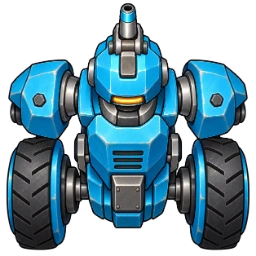
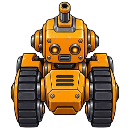
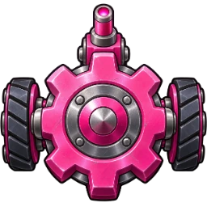
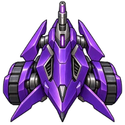
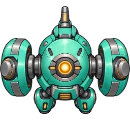
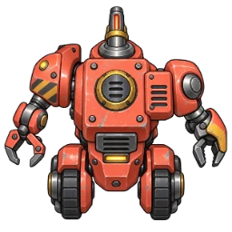
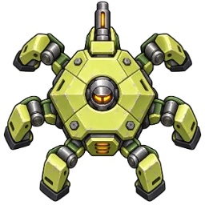
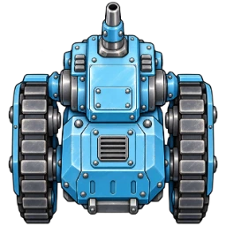
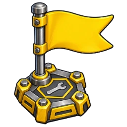

# Robot artwork and flag repairs

The board used colored letter blocks for robots and plain numbered circles for
flags. This change gives all eight robots distinct painted metal bodies, while
keeping their familiar colors. The same robot asset appears on the board,
in the robot picker, on tabletop mats, and on web player cards. The forward
barrel points north in the source asset; existing facing rotations and playback
movement rotate the whole robot. Board pieces shrink with their cells on dense
courses so adjacent robots do not overlap. Existing active-player and execution highlights
remain in place.

| Axle | Bit | Cog | Dash |
| --- | --- | --- | --- |
|  |  |  |  |

| Flux | Gizmo | Hex | Rivet |
| --- | --- | --- | --- |
|  |  |  |  |

The flag has a wrench emblem on its base. Its number stays live text for crisp
rendering, and team colors remain on the number badge. Accessible robot names,
board-cell descriptions, and facing descriptions remain available.

## Repair correction

Cleanup previously found flags for Option World awards but required a printed
repair tile before removing damage. A flag on ordinary floor therefore never
repaired a robot.

An active robot ending the round on any flag now removes one damage, then
unlocks the registers appropriate to its new damage level. Visiting a flag
during an earlier register does not repair damage. The flag does not need to be
the robot's next objective. Mechanical Arm can reach adjacent flags using its
existing wall-aware reach rules. A flag and wrench occupying the same square
still repair once. Option World's explicit replacement of repairs with Options
is preserved. Moving flags use their current compiled positions.

## Review

- Check color and silhouette recognition on the board, especially Axle versus Rivet.
- Rotate robots and follow playback to check that their forward barrels make facing clear.
- Compare web player cards, tabletop mats, and phone robot selection.
- Check flag numbers and team badges on a large course.
- End a round on a flag with damage and check the cleanup log and released locks.

Pure tests cover damage reduction, register unlocking, register-versus-cleanup
timing, out-of-order flags, overlapping wrench sites, destroyed robots, and
Mechanical Arm reach. Scenario 009 checks that both real clients see exactly
one flag repair at the round boundary. Scenario 032 checks every image loads and the picker names fit; scenario 029
checks robot bodies fit their cells on all published courses. The full browser
suite supplies the cross-device visual review.

## Artwork provenance

Created with the built-in OpenAI image generation tool, one request per asset.
The generated transparent PNGs were reduced to 256-pixel WebP assets with alpha
preserved. The production files live in `static/assets/robots/` and
`static/assets/flags/`; full-resolution originals remain outside the repository.

Robot prompt template:

> Use case: stylized-concept. Asset type: transparent top-down robot sprite for a
> board game, NAME. Single original toy factory robot: DESCRIPTION. Polished
> hand-painted 3D game art with bold dark outlines, simple readable silhouette,
> brushed steel joints, colored enamel panels. Orthographic overhead view, front
> points strictly UP toward top of image, visible short forward laser barrel at
> top center. Robot centered occupying 85% of square canvas, entirely in frame.
> Strong shape readable at 32px. Truly transparent background; no ground, base,
> shadow outside silhouette, lettering, numbers, logos, border or other objects.

Descriptions used:

- Axle: cyan blue, rugged two-wheel axle chassis, broad shoulders.
- Bit: amber orange, compact square head, chunky tank treads.
- Cog: pink magenta, circular gear-shaped chassis, twin side wheels.
- Dash: violet purple, sleek triangular racing chassis, swept fins.
- Flux: mint teal, rounded reactor chassis, two large magnetic side pods.
- Gizmo: coral red, asymmetric workshop chassis, small articulated claw arms.
- Hex: pale yellow green, hexagonal armored shell, six short mechanical legs.
- Rivet: ice blue, riveted heavy rectangular armor, broad caterpillar tracks.

Flag prompt:

> Use case: stylized-concept. Asset type: transparent flag checkpoint sprite for
> a factory robot board game. A single golden yellow racing pennant on a short
> steel pole and compact hexagonal industrial repair platform with a small
> embossed wrench emblem. Polished hand-painted 3D toy game art, bold dark
> outlines, simple clear silhouette readable at 32 pixels. Slight overhead view,
> centered entire object fills square canvas, no ground or outside shadow. Large
> flat blank yellow pennant area for a number overlay added in code. Truly
> transparent background. No text, numbers, watermark, border or other objects.
