# Robot artwork and flag repairs

The board used colored letter blocks for robots and plain numbered circles for
flags. This change gives all eight robots distinct industrial robot bodies using
the same worn gunmetal, brass details, hazard markings, and restrained amber
lighting as the Option illustrations. Chipped color panels retain each robot’s
identity. The same robot asset appears on the board, in the robot picker, on
tabletop mats, and on web player cards. The forward
barrel points north in the source asset; existing facing rotations and playback
movement rotate the whole robot. Board pieces shrink with their cells on dense
courses so adjacent robots do not overlap. Teardrop outlines point in the direction of travel. Your robot keeps a lime
outline at rest and during execution; other robots use their individual colors.
Execution thickens the outline and adds a bright neon glow without changing
its color.

| Axle | Bit | Cog | Dash |
| --- | --- | --- | --- |
| 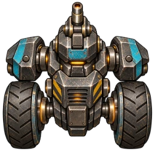 | 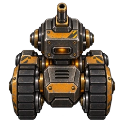 | 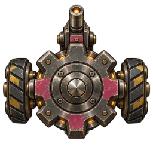 | 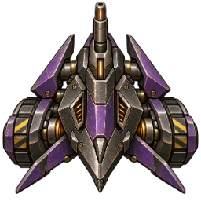 |

| Flux | Gizmo | Hex | Rivet |
| --- | --- | --- | --- |
| 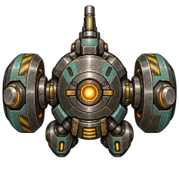 | 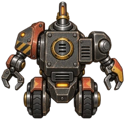 | 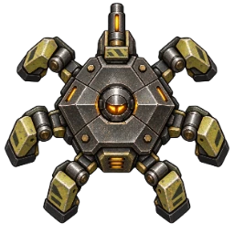 | 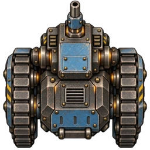 |

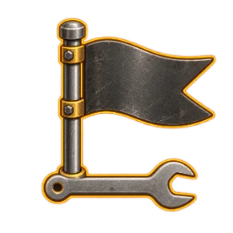

The flag uses the same brushed steel and amber edge lighting as the repair tiles,
with a wrench incorporated into its base. Its number stays live text for crisp
rendering, with a small number on the pennant instead of a large badge. Flags
fill almost the entire tile, and team colors remain on the number. Accessible robot names,
board-cell descriptions, and facing descriptions remain available.

## Existing art for comparison

These existing assets were used as direct visual references for the revised
robot and flag artwork. Robots share the Option illustrations’ materials and
lighting; flags share the repair tiles’ steel-and-amber icon treatment.

| Repair tile | Conveyor tile | Program card frame |
| --- | --- | --- |
| 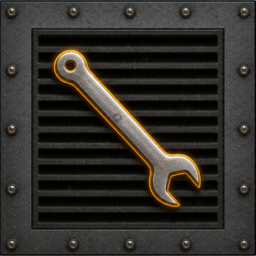 | 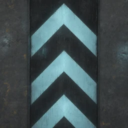 | 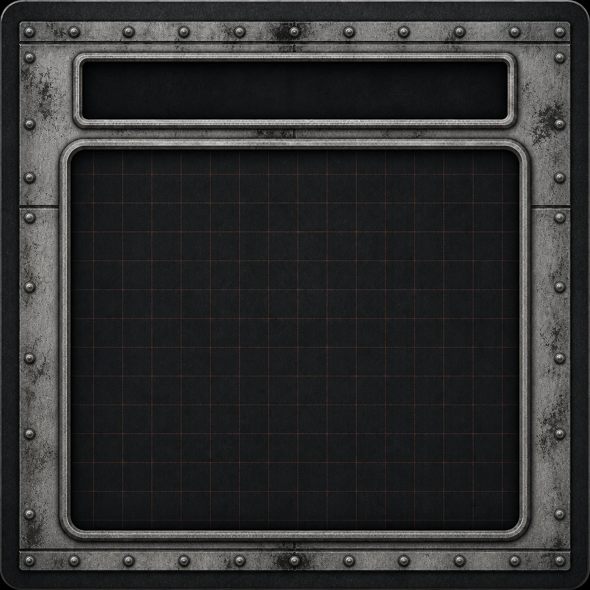 |

| Brakes Option art | Mechanical Arm Option art | Ablative Coat Option art |
| --- | --- | --- |
| 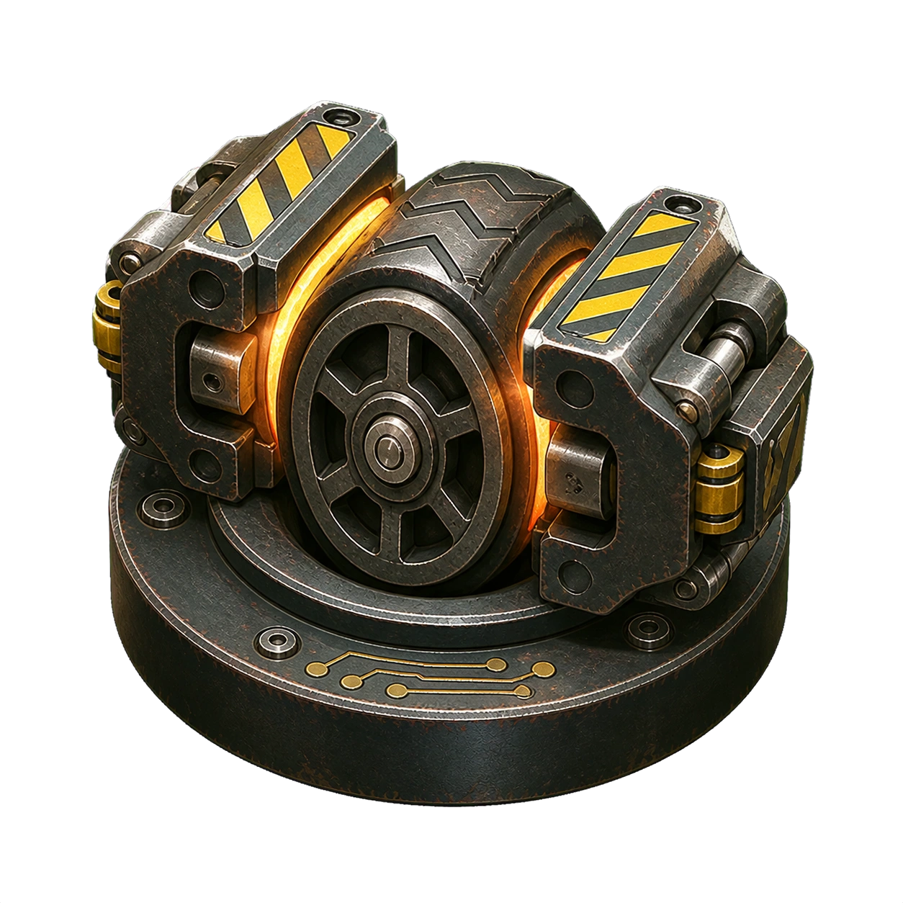 | 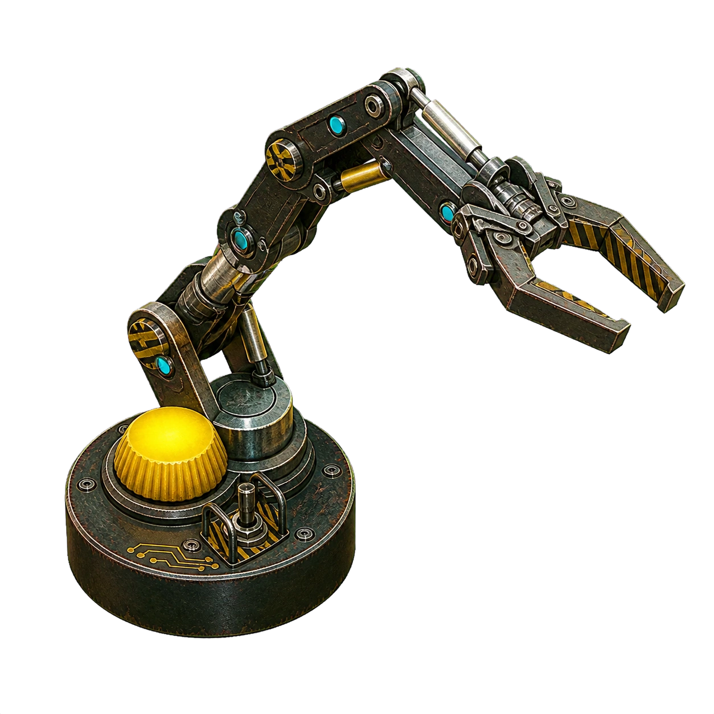 | 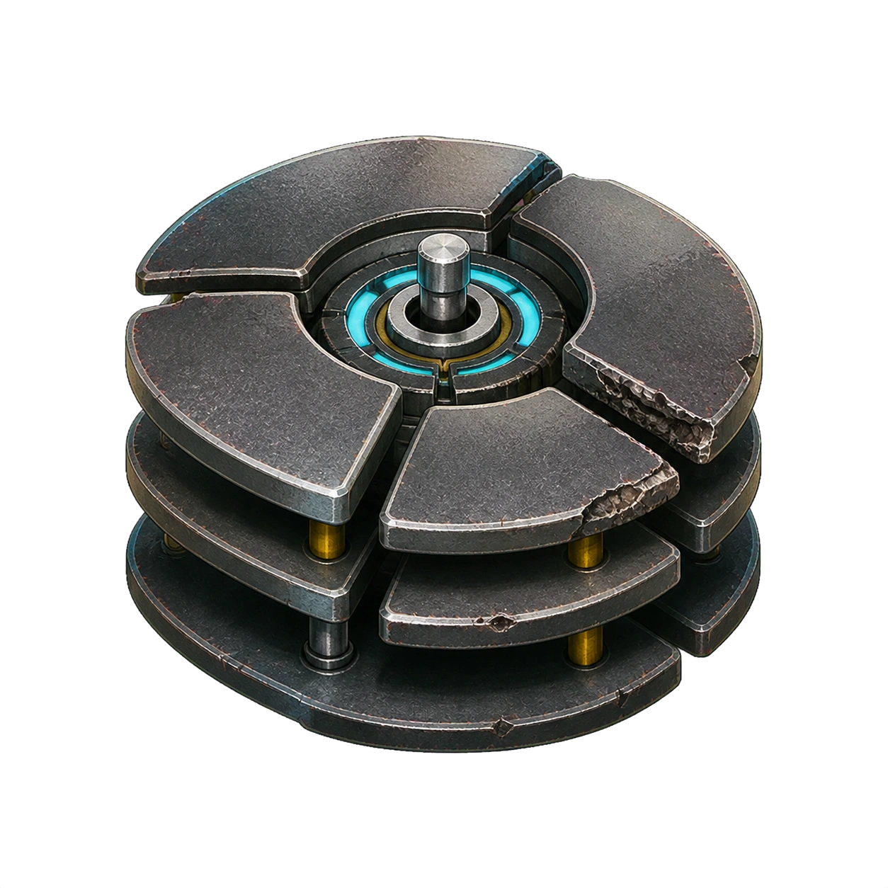 |

This revised set replaces the initial glossy enamel proposal. Check that the
shared material treatment is convincing while the color panels and silhouettes
remain distinguishable at board size.

## Repair correction

Cleanup previously found flags for Option World awards but required a printed
repair tile before removing damage. A flag on ordinary floor therefore never
repaired a robot.

An active robot ending the round on any flag now removes one damage, then
unlocks the registers appropriate to its new damage level. Visiting a flag
during an earlier register does not repair damage. The flag does not need to be
the robot's next objective. Mechanical Arm can reach adjacent flags using its
existing wall-aware reach rules. A flag and wrench occupying the same square
still repair once. Option World's explicit replacement of repairs with Options
is preserved. Moving flags use their current compiled positions.

## Review

- Check color and silhouette recognition on the board, especially Axle versus Rivet.
- Rotate robots and follow playback to check that their forward barrels make facing clear.
- Compare web player cards, tabletop mats, and phone robot selection.
- Check flag numbers and team badges on a large course.
- End a round on a flag with damage and check the cleanup log and released locks.

Pure tests cover damage reduction, register unlocking, register-versus-cleanup
timing, out-of-order flags, overlapping wrench sites, destroyed robots, and
Mechanical Arm reach. Scenario 009 checks that both real clients see exactly
one flag repair at the round boundary. Scenario 032 checks every image loads and
the picker names fit; scenario 029 checks robot bodies fit their cells on all
published courses. The full browser suite supplies the cross-device visual review.

## Artwork provenance

Created with the built-in OpenAI image generation tool, one request per asset.
The generated transparent PNGs were reduced to 256-pixel WebP assets with alpha
preserved. The production files live in `static/assets/robots/` and
`static/assets/flags/`; full-resolution originals remain outside the repository.

The complete final prompt set and reference assets are recorded in
[robot-art-prompts.json](robot-art-prompts.json). Robots were edited using the
existing Brakes and Mechanical Arm Option illustrations as direct style
references. The flag was edited using the existing single and crossed repair
tiles. Each edit retained transparency and a clear silhouette for small sizes.
