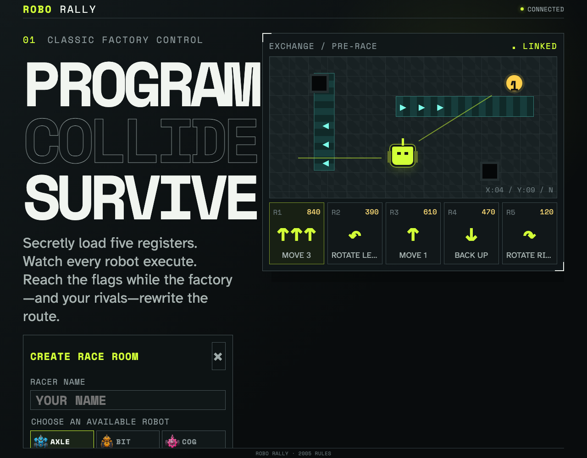
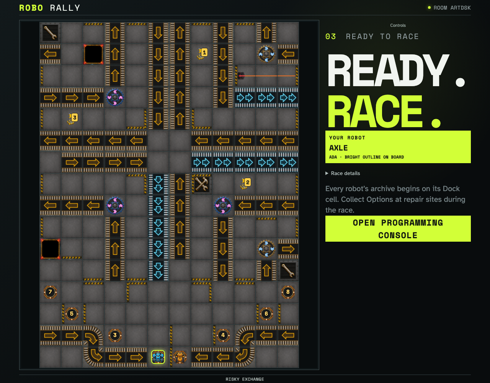

# Choose a robot by its artwork

Eight distinct robots load in the real race picker, and the same artwork joins numbered flag checkpoints on the configured board.

## All eight robots have readable names and distinct artwork

**Verifications:**

- [x] Every robot image loads and every named robot can be selected

## Robot bodies and numbered wrench flags share the playable board

**Verifications:**

- [x] Both clients load the two robots and three numbered graphical flags
