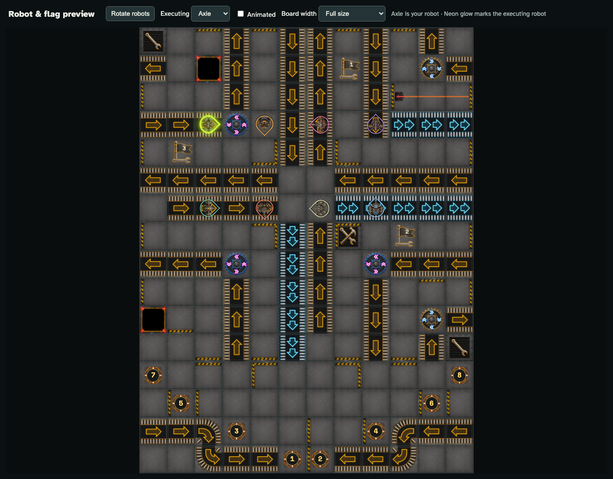

# Review robot headings and flag numbers

The standalone art preview uses the real board and its fonts, with controls for headings, execution highlights, and board size.

## Flag numbers stay on the pennants as the board changes size

**Verifications:**

- [x] The game font loads on a fresh visit, and flag numbers stay centred at phone, desktop, and full width
